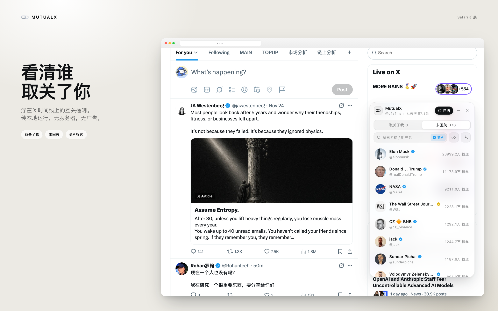
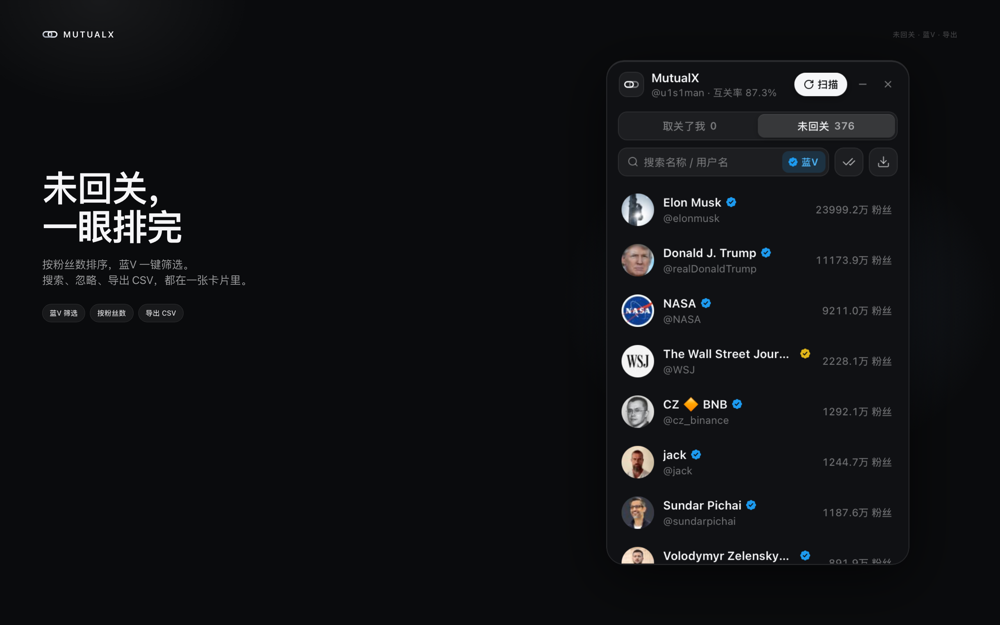
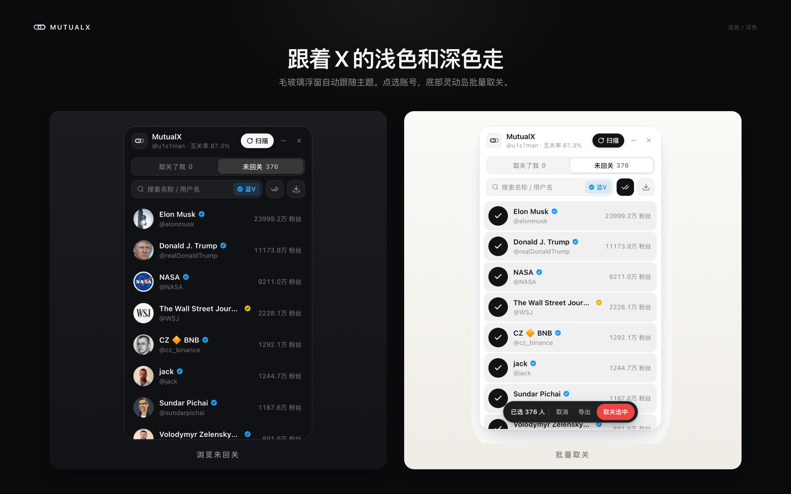

  
  <h1>MutualX</h1>
  
<strong>A minimalist, 100% local mutual-follow checker for X (Twitter).</strong>

  
See who unfollowed you and who doesn't follow back — right on your X timeline, with zero servers and zero tracking.

  

    <strong>English</strong> · <a href="./README.zh-CN.md">简体中文</a>
  

  

    <code>Safari · macOS 13+</code> ·
    <code>Chrome Extension</code> ·
    <code>100% Local &amp; Private</code> ·
    <code>21 Languages</code>
  

 

  

---

## Why MutualX?

Managing your following list on X shouldn't require handing over your login credentials, paying for bloated third-party dashboards, or leaving your timeline.

**MutualX** lives right inside X as a featherweight, frosted-glass floating card. It reads your following list using your existing browser session, compares it against your local mutual-follow baseline, and gives you clean controls to inspect, filter, ignore, export, or batch-unfollow — without a single byte ever leaving your computer.

---

## Key Features

### 1. Instant Unfollower & Non-Follower Detection
- **Unfollowed Me** — Automatically tracks who used to follow you back and recently unfollowed you, compared against your local baseline.
- **Not Following Back** — Lists every account you follow that doesn't follow you back, sorted by follower count so you can spot public figures vs. everyday accounts at a glance.
- **Live Mutual Ratio** — Displays your real-time mutual-follow percentage right in the card header.

  

### 2. Built for Speed & Clarity
- **Verified Filter** — Toggle verified accounts (blue, gold, or gray badges) with one click so you can keep creators and news outlets untouched while cleaning up the rest.
- **Instant Search** — Filter by display name or `@handle` in real time.
- **Smart Ignore List** — Mark specific accounts as ignored so they stay out of your cleanup list across future scans.
- **One-Click CSV Export** — Export any filtered view to a clean CSV file for backup or offline review.

### 3. Effortless Batch Cleanup & Undo Safety
- **Avatar-as-Selector** — Click avatars to select individual accounts, or toggle Select All in one click.
- **Floating Action Bar** — A compact Dynamic Island–style bar appears at the bottom when accounts are selected, letting you export or batch-unfollow cleanly.
- **Explicit Confirmation & Undo** — Every unfollow action requires your confirmation and includes a quick undo toast for single-account actions.

### 4. Native Light & Dark Themes
- **Automatic Theme Sync** — Follows X's Light, Dim, and Lights Out themes seamlessly with native frosted-glass styling.
- **Draggable & Minimizable** — Drag the floating card anywhere on screen or collapse it into a tiny corner pill whenever you want an unobstructed timeline.

  

---

## Privacy First — By Architecture

MutualX has **no backend server, no analytics, no ads, and no third-party tracking SDKs**.

| Principle | How MutualX Handles It |
| :--- | :--- |
| **100% Local Storage** | Scan results, mutual baselines, ignore lists, and card position are stored solely in your browser's local extension storage, isolated per X account. |
| **No Extra Login / OAuth** | Uses your active logged-in `x.com` browser session directly — never asks for passwords or third-party API tokens. |
| **Zero Tracking** | No telemetry, no crash reporters, no external network calls outside `x.com` and `twitter.com`. |
| **Clean Removal** | Uninstalling MutualX immediately removes all locally stored data. |

See [privacy.html](./privacy.html) for the full Privacy Policy.

---

## Global Language Support

MutualX adapts automatically to your browser language across **21 languages**:

English · 简体中文 · 繁體中文 · 日本語 · 한국어 · Español · Français · Deutsch · Português (Brasil) · Italiano · Nederlands · Polski · Русский · Українська · Türkçe · Svenska · العربية · हिन्दी · ไทย · Tiếng Việt · Bahasa Indonesia

---

## Quick Start (Safari on macOS)

1. Install **MutualX** from the Mac App Store and launch the app once.
2. Open **Safari → Settings → Extensions** and enable **MutualX**.
3. Allow website access for `x.com` and `twitter.com`.
4. Open X and click the **MutualX** icon in the Safari toolbar to start scanning.

---

## FAQ

**Does MutualX work with multiple X accounts?**  
Yes. Local scan snapshots, mutual baselines, and ignore lists are stored separately for each logged-in X account.

**Why does "Unfollowed Me" show 0 on my very first scan?**  
The first scan establishes your mutual-follow baseline locally. On subsequent scans, any previously mutual account that stopped following you will appear under **Unfollowed Me**.

**Will MutualX unfollow anyone automatically?**  
Never. Unfollow requests are sent only when you explicitly click **Unfollow** or **Unfollow Selected** and confirm.

**Is MutualX affiliated with X Corp.?**  
No. MutualX is an independent utility and is not affiliated with, endorsed by, or sponsored by X Corp.

---

## Support & Feedback

- **Support & Quick Start**: [index.html](./index.html)
- **Privacy Policy**: [privacy.html](./privacy.html)
- **Bug Reports & Feature Requests**: Open an issue in this repository and include your browser version and macOS/OS version.
