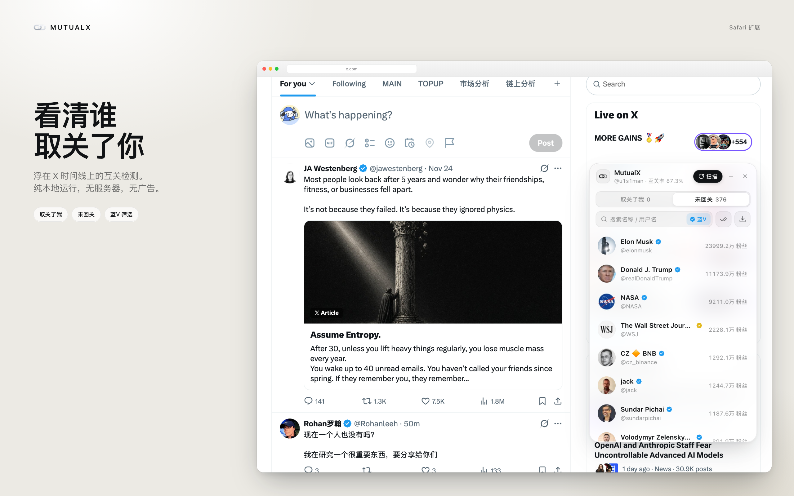
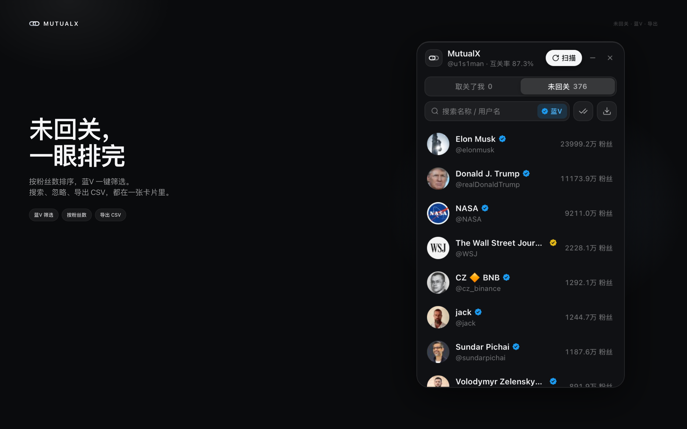
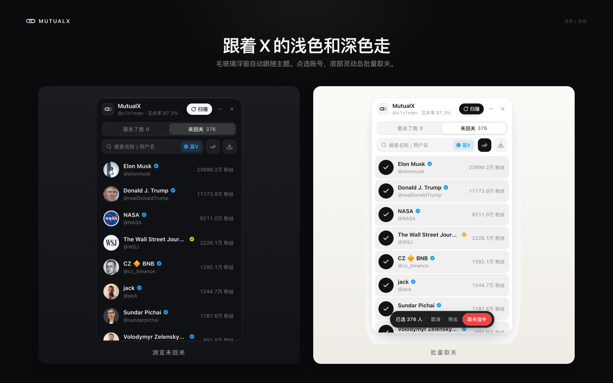

  
  <h1>MutualX</h1>
  
<strong>轻量、纯本地运行的 X（Twitter）互关检测扩展。</strong>

  
直接在 X 时间线上查看谁取关了你、谁未回关——无服务器、无追踪、无广告。

  

    <a href="./README.md">English</a> · <strong>简体中文</strong>
  

  

    <code>Safari · macOS 13+</code> ·
    <code>Chrome 扩展</code> ·
    <code>100% 纯本地隐私</code> ·
    <code>21 种语言</code>
  

 

  

---

## 为什么选择 MutualX？

整理 X 的关注列表，不需要交出账号密码，不需要订阅臃肿的第三方后台，也不必离开你正在浏览的时间线。

**MutualX** 以一张极简毛玻璃悬浮卡片的形式直接贴合在 X 页面之上：复用你当前已登录的浏览器会话扫描关注列表，与本地历史互关基线自动比对，帮你清晰完成筛选、忽略、导出与批量整理——全过程没有任何数据离开你的设备。

---

## 核心特性

### 1. 一目了然的互关与取关检测
- **取关了我**：自动与本地历史互关基线比对，精准识别曾经互关、近期取消关注你的账号。
- **未回关列表**：完整列出你关注了但未回关的账号，按粉丝数从高到低排序，名人媒体与普通账号一眼区分。
- **实时互关率**：卡片顶部直接展示当前账号的互关比例，状态变化一目了然。

  

### 2. 为高频整理打造的轻快交互
- **蓝 V 一键筛选**：快速筛选或排除认证账号，整理关注列表时轻松保留常看的博主与官方媒体。
- **即时搜索**：按昵称或 `@用户名` 实时过滤结果。
- **忽略名单**：把不想再被提醒的账号加入忽略，后续扫描自动保持安静。
- **一键导出 CSV**：将当前筛选结果导出为标准 CSV 表格，方便备份或离线整理。

### 3. 顺手的批量操作与防误触保护
- **点击头像即选中**：无需额外复选框，轻点头像即可多选，也支持一键全选。
- **底部灵动岛操作栏**：选中账号后底部自然浮现操作条，支持批量导出或批量取关。
- **二次确认与撤销**：所有取关操作均需你主动确认，单条取关后提供快捷撤销提示。

### 4. 自动跟随 X 的浅色与深色主题
- **原生质感融合**：自动适配 X 的浅色、暗蓝与纯黑主题，毛玻璃浮窗融入页面不突兀。
- **自由拖拽与收纳**：卡片可拖拽至屏幕任意位置，也可一键最小化为角落胶囊，随时不挡视野。

  

---

## 架构级隐私保护

MutualX **没有后端服务器、没有统计埋点、没有广告，也不引入任何第三方追踪 SDK**。

| 隐私原则 | 实现方式 |
| :--- | :--- |
| **100% 本地存储** | 扫描结果、历史互关基线、忽略名单与浮窗位置全部存在浏览器本地扩展存储中，多账号自动隔离。 |
| **无需重新登录 / OAuth** | 直接使用当前已登录的 `x.com` 网页会话，不索取密码或第三方 API 密钥。 |
| **零追踪零上传** | 无统计分析、无崩溃上报，除访问 `x.com` / `twitter.com` 外不发起任何外部请求。 |
| **卸载即清空** | 在浏览器中卸载 MutualX 后，所有本地数据随之彻底删除。 |

查看完整隐私政策：[privacy.html](./privacy.html)。

---

## 全球 21 种语言原生适配

自动跟随浏览器语言切换界面，完整支持：

简体中文 · 繁體中文 · English · 日本語 · 한국어 · Español · Français · Deutsch · Português (Brasil) · Italiano · Nederlands · Polski · Русский · Українська · Türkçe · Svenska · العربية · हिन्दी · ไทย · Tiếng Việt · Bahasa Indonesia

---

## 快速开始（macOS Safari）

1. 从 Mac App Store 安装 **MutualX**，首次打开应用完成注册。
2. 前往 **Safari 浏览器 → 设置 → 扩展**，勾选启用 **MutualX**。
3. 允许 MutualX 访问 `x.com` 与 `twitter.com`。
4. 打开 X 页面，点击工具栏中的 **MutualX** 图标即可开始扫描。

---

## 常见问题

**支持多个 X 账号吗？**  
支持。每个登录账号的扫描记录、互关基线与忽略名单均在本地独立保存，互不干扰。

**为什么第一次扫描时「取关了我」显示为 0？**  
首次扫描会在本地建立你的互关基线；之后再次扫描时，曾与你互关但取消关注的账号就会出现在「取关了我」列表中。

**MutualX 会自动帮我取关吗？**  
不会。只有在你主动点击「取关」或「取关选中」并二次确认后，才会向 X 发起取消关注请求。

**MutualX 是 X 官方扩展吗？**  
不是。MutualX 为独立开发的实用工具，与 X Corp. 无任何关联。

---

## 支持与反馈

- **使用帮助与快速开始**：[index.html](./index.html)
- **隐私政策**：[privacy.html](./privacy.html)
- **问题反馈与建议**：欢迎直接在本仓库提交 Issue，附上你的浏览器版本与系统版本，我们会尽快处理。
